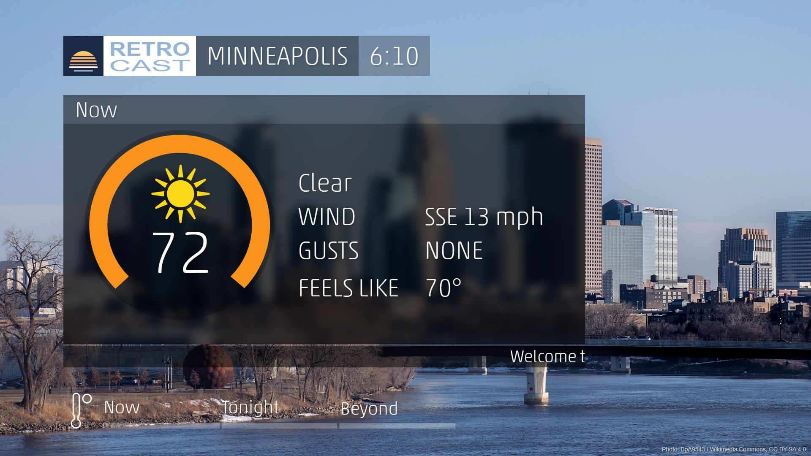
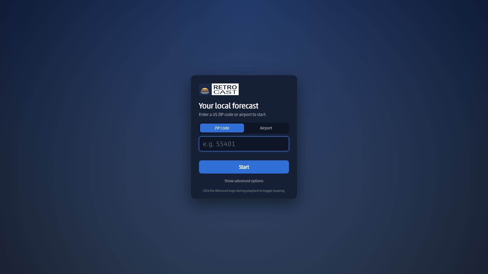
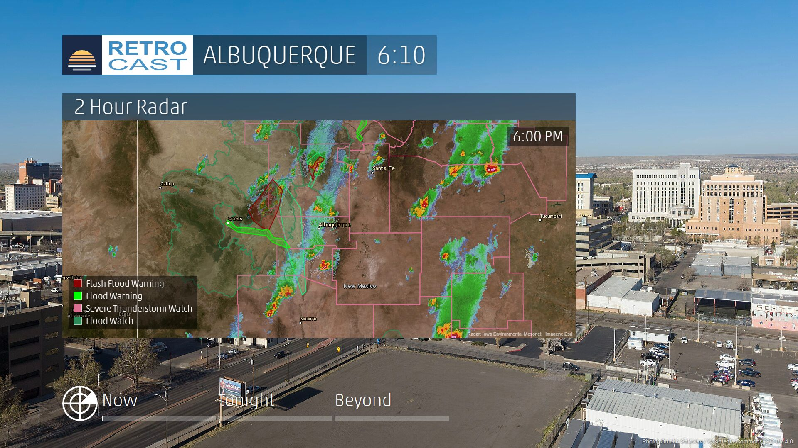
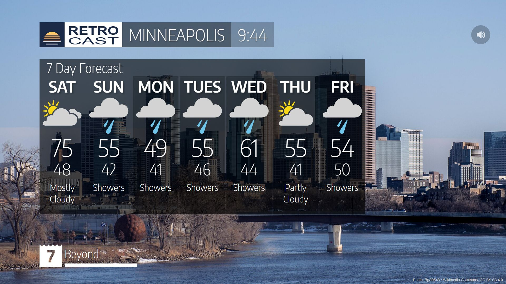

# Retrocast

A retro local forecast for any US ZIP code. Retrocast plays a minute-long forecast loop in the style of the classic cable TV local weather segment: current conditions, radar, the forecast and a 7 day outlook. No API keys or accounts needed.

## Features
- **Live current conditions** from the nearest National Weather Service station
- **Forecast and 7 day outlook** from the NWS, with [Open-Meteo](https://open-meteo.com) filling in days past the NWS forecast range
- **2 hour animated radar** with county lines, city names and active watches, warnings and advisories drawn on the map in the official NWS hazard colors
- **Severe weather alerts** shown at the start of the loop, with a zoomed radar for the location
- **Backgrounds that match the forecast**: a photo of the location, or a featured photo matching the current conditions (rain, snow, fog, lightning, clouds or a clear night sky)
- **Looping** for kiosks and spare screens, with fresh data every cycle
- **ZIP code or airport code** (like MSP or KMSP) locations

Only US locations are supported, since the weather data comes from the National Weather Service.

## Getting started

### Run it in a browser
1. Download or clone this repository
2. Open `index.html` in a modern browser (Chrome works best)
3. Enter a ZIP code or airport code and click **Start**
4. Press F11 for full screen

### Run it with Docker Compose
1. Download or clone this repository
2. `docker compose up -d`
3. Visit http://localhost:8080

This uses the published image, `ghcr.io/justin-braun/retrocast`, and restarts it automatically if the machine reboots. To build from your local copy instead, for example after making changes, run `docker compose up -d --build`. To change the port, edit `8080` in [compose.yaml](compose.yaml).

### Run it with Docker
1. `docker run -d -p 8080:80 --restart unless-stopped ghcr.io/justin-braun/retrocast`
2. Visit http://localhost:8080

To build the image yourself instead: `docker build -t retrocast .` then `docker run -p 8080:80 retrocast`.

## Looping
Retrocast loops by default, which suits kiosks and spare screens. Each time the forecast ends, the page reloads and fetches new data, about once a minute. To play the forecast just once, turn off **Loop continuously** on the start screen.

To stop looping during playback, press Esc or click the Retrocast logo in the top left corner. The start screen comes back when the current forecast ends. Clicking the logo again turns looping back on.

To start without typing, for example on a kiosk, open Retrocast with the location in the link:
- `http://localhost:8080/?zip=55401` for a ZIP code
- `http://localhost:8080/?airport=MSP` for an airport
- Add `&loop=0` to play once instead of looping, like `?zip=55401&loop=0`

If the music doesn't play when looping, the browser is blocking autoplay. In Chrome you can allow it at `chrome://flags#autoplay-policy` by choosing `No user gesture is required`.

## Customizing
Click **Show advanced options** on the start screen to change the crawl text that scrolls along the bottom and the greeting shown at the start.

## Screenshots

## Data and credits
Retrocast uses free services that don't need a key:
- Weather, forecasts, alerts and zone shapes: [National Weather Service API](https://www.weather.gov/documentation/services-web-api)
- Radar: [Iowa Environmental Mesonet](https://mesonet.agron.iastate.edu) NEXRAD mosaic
- Map imagery: [Esri](https://www.esri.com)
- County and state lines and city names: [US Census Bureau TIGERweb](https://tigerweb.geo.census.gov)
- Extended outlook: [Open-Meteo](https://open-meteo.com)
- ZIP code lookup: [Zippopotam.us](https://zippopotam.us)
- Background photos: [Wikimedia Commons](https://commons.wikimedia.org) and [Wikipedia](https://www.wikipedia.org), credited on screen

Bundled assets:
- Font: [Encode Sans Semi Condensed](https://fonts.google.com/specimen/Encode+Sans+Semi+Condensed) by The Encode Project Authors, under the SIL Open Font License ([fonts/OFL.txt](fonts/OFL.txt))
- Music: public domain tracks from [FreePD.com](https://archive.org/details/freepd) and an original jingle, listed in [assets/music/CREDITS.md](assets/music/CREDITS.md)

Retrocast started as a fork of [intellistar-emulator](https://github.com/qconrad/intellistar-emulator) by qconrad and its contributors, and keeps its MIT license.

Retrocast is an independent project and isn't affiliated with any broadcaster or with the National Weather Service.
